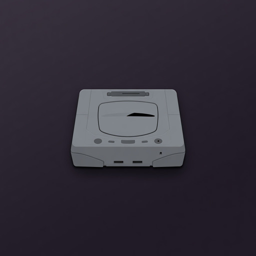

# Sega Saturn Documentation Repository

  

## Purpose

**Historical archival mirror** of Sega Saturn developer documentation and related tooling, so the materials remain available offline if upstream hosts disappear. Primary bulk is the Antime ST- / Hitachi / tools corpus under `files/`, plus index markdown for navigation.

Curated **offline** collection of Sega Saturn engineering specs, programmer guides, manuals, reverse-engineering notes, and expanded documentation.

**All official PDFs are local** under [`files/`](files/) (103 manuals mirrored from Antime). Full index: [`official/st-documents.md`](official/st-documents.md).

> **Recovery note (2026-08-04):** This tree was rebuilt after an accidental local/GitHub deletion. The **103 Antime PDFs** were re-downloaded from the public Antime mirror. Synthesized markdown under `hardware/`, `software/`, and `reverse-engineering/` may need re-expansion if GitHub soft-delete restore is not used. Prefer restoring the original repo from GitHub **Settings → Repositories → Deleted repositories** when available (up to 90 days).

## Local Primary Sources

| Source | Local path |
|--------|------------|
| Antime ST- / Hitachi / tools PDFs | [`files/*.pdf`](files/) (103 files) |
| Antime index HTML snapshot | [`files/html/antime-docs-index.html`](files/html/antime-docs-index.html) |
| Copetti Saturn architecture | [`files/html/copetti-saturn.html`](files/html/copetti-saturn.html) |
| Developer’s Documentation v2.50 (EN+JP, 1997-08-25) | [`files/ssddv25/index.html`](files/ssddv25/index.html) |
| Developer’s Documentation v2.50 (original Japanese) | [`files/ssddv25-jp/index.htm`](files/ssddv25-jp/index.htm) |
| Developer’s Documentation Vol. 1 Rel. 1 (Japanese, A19-1000, 1996-04-20) | [`files/ssddv1-jp/HYOUSI.HTM`](files/ssddv1-jp/HYOUSI.HTM) |
| Same Vol. 1, 2019 English translation | [`files/ssddv1-en/hyousi.htm`](files/ssddv1-en/hyousi.htm) |
| Saturn PAL service manuals | [`files/service/`](files/service/) |

## Core Official Manuals (quick links)

### Programming Manual Vol. 1
- [Saturn Introduction Manual](files/ST-155-062094.pdf) (`ST-155-062094.pdf`)
- [SOA Introduction to Saturn Game Development](files/13-APR-94.pdf)
- [Saturn Overview Manual](files/ST-103-R1-040194.pdf)
- [SCU User's Manual](files/ST-097-R5-072694.pdf)
- [SCU Final Specs: Precautions](files/ST-210-110194.pdf)
- [SMPC User's Manual](files/ST-169-R1-072694.pdf)
- [SCSP User's Manual](files/ST-077-R2-052594.pdf)
- [Dual CPU User's Guide](files/ST-202-R1-120994.pdf)

### Programming Manual Vol. 2
- [VDP1 User's Manual](files/ST-013-R3-061694.pdf) + [Supplement](files/ST-013-SP1-052794.pdf)
- [VDP2 User's Manual](files/ST-058-R2-060194.pdf)

### Development tools / standards
- [Software Development Standards](files/ST-151-R4-020197.pdf)
- [Boot ROM User's Manual](files/ST-079B-R3-011895.pdf)
- [Disc Format Standards](files/ST-040-R4-051795.pdf) — IP.BIN, ISO9660, track order, security
- [Backup System Production Standard](files/ST-203-100494.pdf)
- SCU DSP: `files/ST-240-*.pdf`
- [Technical Bulletins (Sattechs)](files/Sattechs.pdf) + `files/ST-TECH-*.pdf`

### Libraries
- SBL / SGL: [ST-237](files/ST-237-R1-051795.pdf), [ST-238](files/ST-238-R1-051795.pdf)

### Hitachi / Renesas (SH-2)
- [SH-1/SH-2 Programming Manual](files/h12p0.pdf)
- [SH7604 Hardware Manual](files/sh7604.pdf)
- Assembler / C compiler / simulator: `files/shccomp.pdf`, `files/e702090_superh.pdf`, `files/e702186_shsimulator.pdf`, …

### Other
- [Motorola 68000 PRM](files/M68000PRM.pdf) (sound CPU)
- DTS newsletters: `files/DTS-*.pdf`
- Tools manuals: `files/3DEdit.pdf`, `MapEdit.pdf`, `SprEdit.pdf`, …

**Complete enumerated list:** [`official/st-documents.md`](official/st-documents.md)

## Hardware (detailed MD in this repo)

| Topic | Summary | Local manuals |
|-------|---------|---------------|
| SH-2 | [`hardware/sh2.md`](hardware/sh2.md) | `h12p0.pdf`, `sh7604.pdf` |
| VDP1 | [`hardware/vdp1.md`](hardware/vdp1.md) | `ST-013-*.pdf` |
| VDP2 | [`hardware/vdp2/modes.md`](hardware/vdp2/modes.md) | `ST-058-R2-060194.pdf` |
| SMPC | [`hardware/smpc/peripherals.md`](hardware/smpc/peripherals.md) | `ST-169-R1-072694.pdf`, `ST-TECH-44/45` |
| SCSP | [`hardware/scsp.md`](hardware/scsp.md) | `ST-077-R2-052594.pdf` |
| SCU | [`hardware/scu.md`](hardware/scu.md) | `ST-097-R5-072694.pdf`, `ST-240-*` |
| CD Block | [`hardware/cdblock.md`](hardware/cdblock.md) | `ST-040-R4-051795.pdf` |
| Memory | [`hardware/memory.md`](hardware/memory.md) | manuals above |
| Boot / IP.BIN | [`hardware/boot/ipbin.md`](hardware/boot/ipbin.md) | `ST-040`, Boot ROM |

## Software
- SGL: [`software/sgl.md`](software/sgl.md) → `ST-237` / `ST-238`
- SBL: [`software/sbl.md`](software/sbl.md)
- Boot ROM: [`software/bootrom.md`](software/bootrom.md) → `ST-079B-R3-011895.pdf`
- Standards: [`software/development-standards.md`](software/development-standards.md) → `ST-151-R4-020197.pdf`

## Reverse Engineering
- Quirks: [`reverse-engineering/quirks.md`](reverse-engineering/quirks.md)
- Technical bulletins: [`reverse-engineering/technical-bulletins.md`](reverse-engineering/technical-bulletins.md) → `files/Sattechs.pdf`, `ST-TECH-*`
- Anti-piracy: [`reverse-engineering/anti-piracy.md`](reverse-engineering/anti-piracy.md)
- Offline architecture write-up: [`files/html/copetti-saturn.html`](files/html/copetti-saturn.html)

## Tools
- Compilers: [`tools/compilers.md`](tools/compilers.md) — Hitachi / KPIT docs in `files/`
- Emulators: [`tools/emulators.md`](tools/emulators.md)

## Coverage Note

Official ST- documents are **local PDFs** (no external download required for the Antime set). Markdown under `hardware/`, `software/`, and `reverse-engineering/` synthesizes manuals + validated emulator RE (Ymir/Kronos-class).

## Japanese electronic manuals (later than the Antime ST set)

The Antime PDFs are the English ST- series. Sega of Japan’s last kit is the August 1997 Developer Tool Kit, documentation **version 2.50** (SBL 6.21 / SGL 3.20 era). Nemesis’s bilingual HTML mirror is under [`files/ssddv25/`](files/ssddv25/) (open `index.html`). The original Japanese tree, whose paths differ, is [`files/ssddv25-jp/`](files/ssddv25-jp/).

Volume 1 Release 1 (CD A19-1000, 1996-04-20) is the earlier electronic edition: Japanese in [`files/ssddv1-jp/`](files/ssddv1-jp/), English translation in [`files/ssddv1-en/`](files/ssddv1-en/). Volume 2 is the orange-cover hybrid PC/Mac CD B20-1000 (Sega IDs 610-5750 and 670-5512, disk version 1996-04-20, PVD 1996-05-07). Redump disc 131109 is one Mode 1 track, 20,322 sectors, SHA-1 `8e9cfdb6dd4f5b57ef2906b4e433ed3acfeef8bf`. No public file mirror of that HTML tree turned up, so it is not in this repo. A second pass also found no public NTSC or Japanese Saturn service PDF under GitHub's file limit. The PAL scans below are the service set.

PAL service scans from the Exodus technical-docs Drive mirrors:

| File | What it is |
|------|------------|
| [`files/service/Sega_Saturn_Service_Manual_PAL.pdf`](files/service/Sega_Saturn_Service_Manual_PAL.pdf) | Saturn PAL service manual |
| [`files/service/Sega_Saturn_Service_Manual_PAL_013-01_part1.pdf`](files/service/Sega_Saturn_Service_Manual_PAL_013-01_part1.pdf) | 013-01 (1995-06), part 1 |
| [`files/service/Sega_Saturn_Service_Manual_PAL_013-01_part2.pdf`](files/service/Sega_Saturn_Service_Manual_PAL_013-01_part2.pdf) | 013-01, part 2 |
| [`files/service/Sega_Saturn_Service_Manual_VA13_PAL_partial.pdf`](files/service/Sega_Saturn_Service_Manual_VA13_PAL_partial.pdf) | VA-13 PAL, partial |

`files/ssddv25/` includes `segahtml/info/hon/sh_dual.exe`, a small dual-SH sample that shipped inside that manual tree.

Last updated: 2026-10-12 — v2.50 and Vol. 1 HTML manuals, plus PAL service scans. The 103 Antime PDFs are unchanged.
